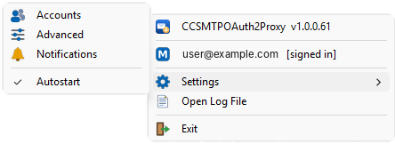
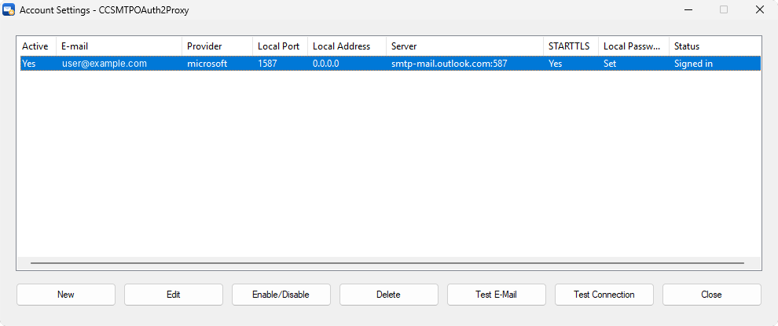
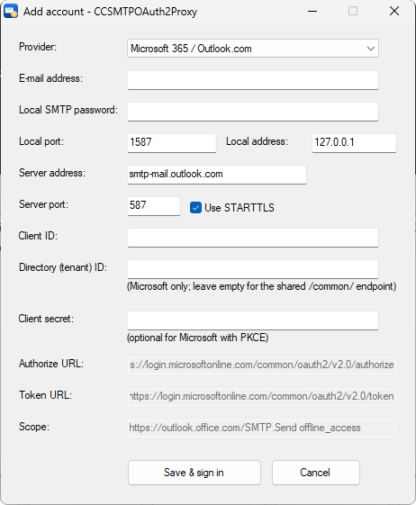
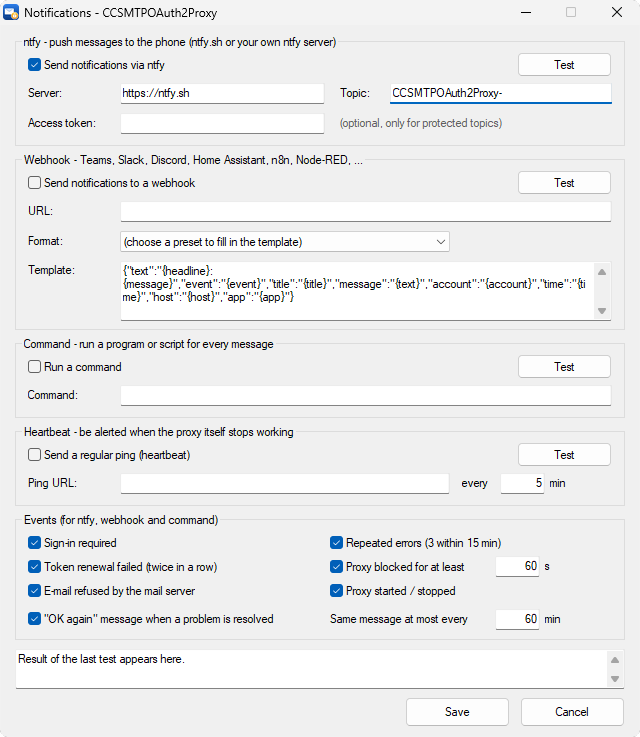
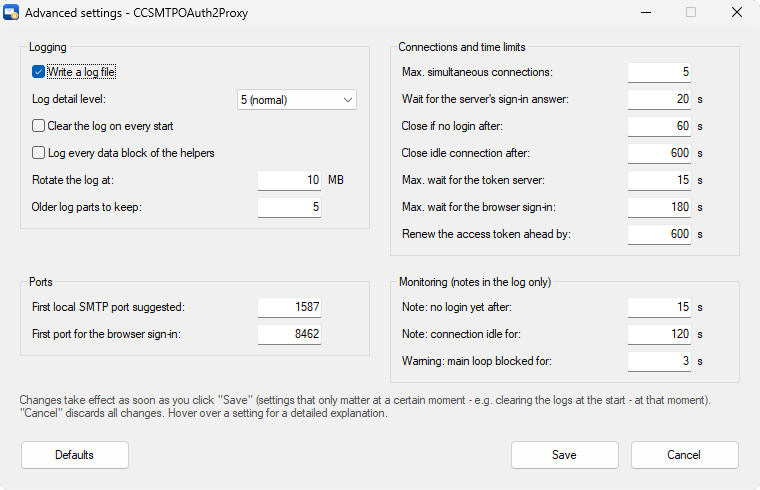
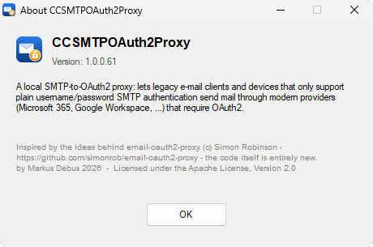

# CCSMTPOAuth2Proxy

A small Windows tray application that lets e-mail clients and devices which
only know plain username/password SMTP login — scanners and printers with
"scan to e-mail", NAS devices, backup and monitoring software, in-house
applications — send mail through **Microsoft 365 / Outlook.com** and
**Google Workspace / Gmail**, which now require **OAuth2** sign-in.

The device talks to a local SMTP listener exactly as before; the proxy signs
in to the real mail server with OAuth2 (XOAUTH2), keeps the access token
fresh, and relays the message over its own TLS connection.

## Features

- One local SMTP listener per account (address/port of your choice), local
  username/password for the device
- OAuth2 authorization-code flow with PKCE in the browser, automatic token
  renewal; Microsoft 365, Google and custom OAuth2 providers
- All secrets (client secrets, local passwords, tokens, webhook URLs)
  encrypted at rest with Windows DPAPI
- Tray menu with per-account status, account settings, advanced settings,
  autostart
- Built-in test e-mail (incl. "Send As" / shared mailbox check) and
  connection test
- Notifications: ntfy (push to the phone), webhooks (Teams Workflows,
  Slack, Discord, Home Assistant, n8n, ...), a command of your own, and a
  heartbeat for monitoring services (healthchecks.io, Uptime Kuma, ...)
- Detailed, rotating log with selectable detail level

## Screenshots

   
  <em>Tray menu: account status, Settings submenu, log file</em>

   
  <em>Account Settings: all accounts with their local listener, server and status</em>

<table>
  <tr>
    <td align="center" valign="top"> <em>Adding an account (Microsoft 365 preset)</em></td>
    <td align="center" valign="top"> <em>Notifications: ntfy, webhook, command, heartbeat</em></td>
  </tr>
  <tr>
    <td align="center" valign="top"> <em>Advanced settings with tooltips for every value</em></td>
    <td align="center" valign="top"> <em>About window</em></td>
  </tr>
</table>

## Requirements

- Windows 10/11 or Windows Server 2019/2022/2025 with Desktop Experience
- Windows PowerShell (included with Windows) — used for the TLS connection
- An app registration at Microsoft Entra ID or Google Cloud (step-by-step
  instructions in the documentation)

## Documentation

The complete documentation — installation, setting up the app registration
at Microsoft and Google, configuring devices, the test e-mail, the log,
notifications, all settings and the roadmap — is in
**[README.txt](README.txt)**.

## Building

The program is a single [AutoIt](https://www.autoitscript.com/) script
(`CCSMTPOAuth2Proxy.au3`). Compile it with AutoIt3Wrapper (SciTE4AutoIt3,
"Compile" / F7). The icons referenced by the `#AutoIt3Wrapper_Icon` and
`#AutoIt3Wrapper_Res_Icon_Add` directives at the top of the script must be
in the `icons` folder next to it; the order of the `Res_Icon_Add` lines
determines the icon numbers used in the script.

Run uncompiled (F5 in SciTE), the program uses the `.ico` files from the
`icons` folder directly and always logs at the most detailed level.

## License

Apache License 2.0 — see [LICENSE.txt](LICENSE.txt) and
[NOTICE.txt](NOTICE.txt).

The general concept of a local SMTP-to-OAuth2 proxy comes from
[email-oauth2-proxy](https://github.com/simonrob/email-oauth2-proxy) by
Simon Robinson. The code of this project is an independent, from-scratch
implementation in AutoIt — no source code of that project was copied or
translated.

Large parts of the code were developed together with Claude (Anthropic) as
a coding assistant.
